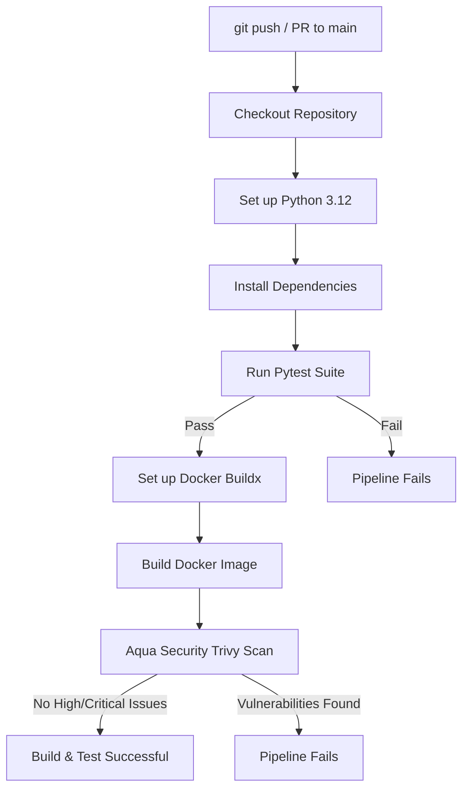

# FastAPI CI/CD Pipeline

A production-ready FastAPI starter project demonstrating automated testing, containerization, vulnerability scanning, and Continuous Integration (CI) with GitHub Actions.

---

## 📁 Project Structure

```text
fastapi-devops/
│
├── app/
│   ├── __init__.py
│   └── main.py              # FastAPI application & route definitions
│
├── tests/
│   └── test_main.py         # Automated API tests using pytest and TestClient
│
├── .github/
│   └── workflows/
│       └── ci.yml           # GitHub Actions automated CI workflow
│
├── Dockerfile               # Production multi-stage / non-root container image
├── .dockerignore            # Excluded files for clean Docker builds
├── .gitignore               # Ignored files for git tracking
├── requirements.txt         # Application and test dependencies
└── README.md                # Project documentation
```

---

## 🚀 API Endpoints

| Method | Endpoint   | Description                 | Query / Body Params | Response Sample |
|:-------|:-----------|:----------------------------|:--------------------|:----------------|
| `GET`  | `/`        | API root & status check     | None                | `{"message": "FastAPI CI/CD Pipeline", "status": "running"}` |
| `GET`  | `/health`  | Health check probe          | None                | `{"status": "healthy"}` |
| `GET`  | `/add`     | Adds two integers together  | `a: int`, `b: int`  | `{"result": 30}` |

Interactive API documentation (Swagger UI) is automatically available at:
- **Swagger UI**: `http://localhost:8000/docs`
- **ReDoc**: `http://localhost:8000/redoc`

---

## 🛠️ Local Development Setup

### 1. Create and Activate Virtual Environment

**Windows (PowerShell):**
```powershell
python -m venv .venv
.\.venv\Scripts\Activate.ps1
```

**macOS / Linux:**
```bash
python3 -m venv .venv
source .venv/bin/activate
```

### 2. Install Dependencies

```bash
python -m pip install --upgrade pip
pip install -r requirements.txt
```

### 3. Run the Development Server

```bash
uvicorn app.main:app --reload --host 0.0.0.0 --port 8000
```

---

## 🧪 Running Automated Tests

Run test suite with detailed output:

```bash
python -m pytest -v
```

Expected result:
```text
tests/test_main.py::test_home PASSED
tests/test_main.py::test_health PASSED
tests/test_main.py::test_add PASSED
tests/test_main.py::test_invalid_input PASSED

4 passed in 0.05s
```

---

## 🐳 Docker Deployment

### 1. Build the Docker Image

```bash
docker build -t fastapi-devops:1.0 .
```

### 2. Run the Container

```bash
docker run -d -p 8000:8000 --name fastapi-container fastapi-devops:1.0
```

### 3. Verify Health Check

```bash
curl http://localhost:8000/health
```

Expected output:
```json
{"status": "healthy"}
```

---

## 🔄 GitHub Actions CI Pipeline

The automated CI pipeline (`.github/workflows/ci.yml`) runs on every `push` and `pull_request` against the `main` branch:



### Pipeline Steps:
1. **Repository Checkout**: Pulls code via `actions/checkout@v4`.
2. **Environment Setup**: Configures Python 3.12 via `actions/setup-python@v5`.
3. **Dependency Installation**: Upgrades `pip` and installs pinned dependencies.
4. **Automated Testing**: Executes `pytest -v` across all test suites.
5. **Docker Build**: Builds the container image tagged with the commit SHA (`fastapi-devops:${{ github.sha }}`).
6. **Security Scanning**: Scans the container image using Aqua Security Trivy (`aquasecurity/trivy-action@0.33.1`) for `HIGH` and `CRITICAL` vulnerabilities. If vulnerabilities are detected, the workflow exits with code `1`.
